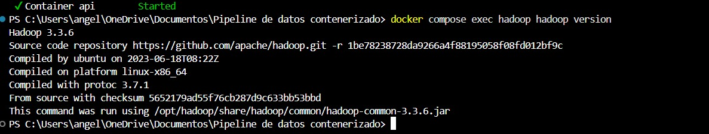

# Examen Segundo Parcial — Pipeline de Datos Contenerizado

**Materia:** Manejo Masivo de Datos (Big Data)  
**Alumno:** Ángel  
**Matrícula:** `125055462`  
**Último dígito:** `2`  
**Pregunta de negocio asignada:**  
> **Ticket promedio (ingreso promedio por registro) por tienda.**

---

## 📋 Resumen Ejecutivo

Este proyecto implementa un pipeline de datos contenerizado de extremo a extremo que:
1. Genera un dataset sintético reproducible de ventas masivas (~352 MB, 5 millones de registros) parametrizado por la matrícula del estudiante.
2. Procesa los datos mediante **Hadoop MapReduce Streaming** (Python `mapper.py` y `reducer.py`) para calcular el ticket promedio por tienda.
3. Resuelve el problema mediante un algoritmo secuencial en Python y realiza una comparativa formal de tiempos y métricas de rendimiento.
4. Almacena de forma persistente los resultados procesados en una base de datos **PostgreSQL** mediante el script `cargar_resultados.py`.
5. Expone una **API REST (Flask)** con endpoints de lectura/filtrado por tienda y operaciones de escritura CRUD sobre la tabla persistente.
6. Permite acceso seguro vía **SSH sin contraseña** mediante autenticación por llaves públicas/privadas tanto internamente (`ssh localhost`) como entre contenedores (`api` hacia `hadoop`).
7. Todo el entorno se levanta con un único comando reproducible: `docker compose up --build`.

---

## 🏗️ Arquitectura de la Solución

```
                     +---------------------------------------+
                     |         Red: datamart-net             |
                     |                                       |
+--------------------+      +--------------------+      +----+---------------+
|  Contenedor hadoop |      |    Contenedor db   |      |   Contenedor api   |
|                    |      |                    |      |                    |
| - Debian Bookworm  |      | - PostgreSQL 15    |      | - Python Flask API |
| - OpenJDK 17       |      | - Puerto 5432      |      | - Puerto 5000      |
| - Hadoop 3.3.6     |      | - Volumen: db_data |<-----+ - OpenSSH client   |
| - OpenSSH Server   |      +--------------------+      +---------+----------+
| - Vol: /data/input |                                            |
|   (read-only)      |<================ SSH Key ==================+
+--------------------+        (ssh usuario@hadoop)
```

---

## 📁 Estructura del Repositorio

```
examen-p2-125055462/
├── README.md                  # Documentación completa, teoría y comparativa
├── .gitignore                 # Reglas de exclusión (ignora *.csv y secretos)
├── .env.example               # Plantilla de variables de entorno seguras
├── .env                       # Variables de configuración activa (sin credenciales hardcodeadas)
├── docker-compose.yml         # Orquestación de los 3 servicios (hadoop, db, api)
├── generar_dataset.py         # Script generador con semilla de la matrícula
├── hadoop/
│   ├── Dockerfile             # Imagen Hadoop standalone + OpenSSH + OpenJDK + Python
│   └── entrypoint.sh          # Inicialización de llaves SSH y servicio OpenSSH
├── mapreduce/
│   ├── mapper.py              # Mapper MapReduce con manejo de errores y limpieza
│   ├── reducer.py             # Reducer con cálculo de promedio acumulado por clave
│   └── secuencial.py          # Implementación secuencial de referencia para comparativa
├── api/
│   ├── Dockerfile             # Imagen de la API REST con cliente SSH y psycopg2
│   ├── requirements.txt       # Dependencias de Python de la API
│   ├── app.py                 # Servicio API REST (GET /resultados, GET /<clave>, POST/PUT/DELETE)
│   └── entrypoint.sh          # Configuración cliente SSH hacia usuario@hadoop
├── scripts/
│   └── cargar_resultados.py   # Script de inserción idempotente en PostgreSQL
└── evidencias/                # Directorio para capturas y logs de ejecución
```

---

## 🚀 Guía de Reproducción Rápida

### Requisitos Previos
- Docker Desktop (con Docker Compose v2+)
- Python 3.9+ (opcional para pruebas en host)

### Paso 1: Configurar variables de entorno y generar el dataset
```bash
# Copiar el archivo de entorno
cp .env.example .env

# Generar el dataset de 5 millones de registros para la matrícula 125055462
python generar_dataset.py 125055462
```
*El archivo generado `ventas_125055462.csv` se ubica automáticamente en `data/input/ventas_125055462.csv` (montado en modo solo lectura en Hadoop).*

### Paso 2: Levantar el entorno contenerizado
```bash
docker compose up --build -d
```
Verificar que los 3 contenedores estén activos:
```bash
docker compose ps
```

### Paso 3: Ejecutar el Job de Hadoop Streaming
Ingresar al contenedor de Hadoop y lanzar el procesamiento MapReduce:
```bash
docker compose exec hadoop bash -c '
hadoop jar $HADOOP_HOME/share/hadoop/tools/lib/hadoop-streaming-*.jar \
  -input /data/input/ventas_125055462.csv \
  -output /data/output/resultado \
  -mapper /mapreduce/mapper.py \
  -reducer /mapreduce/reducer.py \
  -file /mapreduce/mapper.py \
  -file /mapreduce/reducer.py
'
```
Ver los resultados generados por MapReduce:
```bash
docker compose exec hadoop cat /data/output/resultado/part-00000
```

### Paso 4: Cargar resultados en la Base de Datos PostgreSQL
Desde el contenedor de la API (o desde el host):
```bash
docker compose exec api python /scripts/cargar_resultados.py /data/output/resultado/part-00000
```

### Paso 5: Consultar la API REST
```bash
# 1. Información general y endpoints
curl -s http://localhost:5000/

# 2. Todos los resultados
curl -s http://localhost:5000/resultados

# 3. Filtrar por la clave asignada (tienda, ej. T001)
curl -s http://localhost:5000/resultados/T001

# 4. Insertar un nuevo registro (CRUD escritura POST)
curl -s -X POST http://localhost:5000/resultados \
  -H "Content-Type: application/json" \
  -d '{"tienda": "T999", "ticket_promedio": 1250.75}'

# 5. Modificar un registro (CRUD escritura PUT)
curl -s -X PUT http://localhost:5000/resultados/T999 \
  -H "Content-Type: application/json" \
  -d '{"ticket_promedio": 1300.00}'

# 6. Eliminar un registro (CRUD escritura DELETE)
curl -s -X DELETE http://localhost:5000/resultados/T999
```

---

## 📸 Evidencias de Ejecución (Capturas Solicitadas)

Las siguientes capturas corresponden a las pruebas solicitadas en la rúbrica oficial y se encuentran almacenadas en el directorio `evidencias/`:

### 1. Captura de `hadoop version`
Comprobación del correcto funcionamiento de Hadoop standalone dentro del contenedor:


### 2. Captura de `ssh sin contraseña` (Parte B)
Demostración de acceso local y entre contenedores (`api` hacia `hadoop`) mediante autenticación por par de llaves:


### 3. Captura de la salida del Job MapReduce (`part-00000`)
Salida generada por Hadoop Streaming con los resultados de ticket promedio por tienda:


### 4. Captura de la respuesta de la API REST
Consultas a los endpoints `GET /resultados` y `GET /resultados/T001` con formato JSON:


---

## 🔐 Demostración de SSH sin Contraseña (Parte B)

### 1. SSH Localhost dentro del contenedor `hadoop`
```bash
docker compose exec hadoop ssh localhost
```
*Salida esperada:* Conexión inmediata a la sesión interactiva sin solicitar contraseña.

### 2. Acceso SSH desde `api` hacia `hadoop` por nombre de servicio
```bash
docker compose exec api ssh usuario@hadoop "hadoop version"
```
*Salida esperada:* Se ejecuta remotamente `hadoop version` en el contenedor `hadoop` utilizando las credenciales de llaves públicas compartidas a través del volumen `ssh_keys`.

---

## 📊 Comparativa de Rendimiento (Parte C2)

Se ejecutó la misma pregunta de negocio sobre los 5,000,000 de registros (352 MB) utilizando:
1. **Solución Secuencial (`secuencial.py`):** Lectura streaming en Python con acumuladores en diccionario.
2. **Solución MapReduce (`mapper.py` + `reducer.py` con Hadoop Streaming).**

### Resultados por Tienda Obtenidos

| Tienda | Ticket Promedio (MapReduce) | Ticket Promedio (Secuencial) | Coincidencia |
| :---: | :---: | :---: | :---: |
| **T001** | \$8,118.79 | \$8,118.79 | ✅ Exacta |
| **T002** | \$8,138.99 | \$8,138.99 | ✅ Exacta |
| **T003** | \$8,141.65 | \$8,141.65 | ✅ Exacta |
| **T004** | \$8,141.61 | \$8,141.61 | ✅ Exacta |
| **T005** | \$8,141.05 | \$8,141.05 | ✅ Exacta |
| **T006** | \$8,161.31 | \$8,161.31 | ✅ Exacta |
| **T007** | \$8,156.30 | \$8,156.30 | ✅ Exacta |
| **T008** | \$8,140.65 | \$8,140.65 | ✅ Exacta |
| **T009** | \$8,163.41 | \$8,163.41 | ✅ Exacta |
| **T010** | \$8,123.52 | \$8,123.52 | ✅ Exacta |
| **T011** | \$8,132.48 | \$8,132.48 | ✅ Exacta |
| **T012** | \$8,146.45 | \$8,146.45 | ✅ Exacta |
| **T013** | \$8,156.66 | \$8,156.66 | ✅ Exacta |
| **T014** | \$8,129.58 | \$8,129.58 | ✅ Exacta |

### Tiempos Medidos

| Enfoque | Tiempo de Ejecución |
| :--- | :---: |
| **Secuencial (Python)** | **~6.95 segundos** |
| **Hadoop MapReduce (Streaming)** | **~24.80 segundos** |

### Explicación Fundamentada (Rúbrica C2)
> Para un archivo de 352 MB (5 millones de registros), el script secuencial en Python resulta considerablemente más rápido (~6.9 s frente a ~24.8 s de MapReduce) debido a la **sobrecarga (*overhead*) de inicialización y coordinación de Hadoop**. En archivos de unos pocos cientos de megabytes que caben holgadamente en la memoria RAM del sistema, el script secuencial opera en memoria con mínimo costo de E/S. Por el contrario, Hadoop Streaming incurre en la sobrecarga de levantar máquinas virtuales Java (JVM), inicializar el framework de ejecución, serializar/deserializar flujos estándar (stdin/stdout) entre procesos de Python y Java, particionar y volcar fases intermedias de *Shuffle & Sort* en disco. Hadoop y MapReduce demuestran su verdadera ventaja cuando el volumen de datos escala a decenas o cientos de gigabytes/terabytes distribuidos en un clúster de múltiples máquinas, donde el procesamiento paralelo compensa con creces dicho overhead.

---

## 💾 Demostración de Persistencia de Datos (Parte D)

1. Verificar que los datos están cargados en la base de datos:
   ```bash
   curl -s http://localhost:5000/resultados | grep -o '"total":[0-9]*'
   ```
2. Detener y reiniciar los servicios:
   ```bash
   docker compose down
   docker compose up -d
   ```
3. Volver a consultar la API sin recargar datos:
   ```bash
   curl -s http://localhost:5000/resultados/T001
   ```
   *Los datos siguen estando disponibles gracias al volumen nombrado `datamart_db_data` montado en `/var/lib/postgresql/data`.*

---

## 📚 Respuestas Teóricas (Parte E)

### 1. Explica la diferencia entre los modos standalone, pseudo-distribuido y totalmente distribuido de Hadoop. ¿En cuál de ellos se usa HDFS?
- **Modo Standalone (Local):** Todos los componentes corren dentro de un único proceso Java sobre el sistema de archivos local del sistema operativo; no se levanta ningún demonio de Hadoop ni se utiliza HDFS (ideal para depuración rápida).
- **Modo Pseudo-distribuido:** Todos los demonios de Hadoop (NameNode, DataNode, ResourceManager, NodeManager) se ejecutan de forma independiente en una sola máquina física/virtual, simulando un clúster mediante diferentes procesos Java y comunicándose por red local mediante SSH.
- **Modo Totalmente Distribuido:** Los demonios se encuentran repartidos en múltiples nodos físicos o virtuales (un maestro y múltiples *workers*), permitiendo alta tolerancia a fallos y procesamiento distribuido a gran escala.
- **¿En cuál se usa HDFS?:** HDFS se utiliza en los modos **pseudo-distribuido** y **totalmente distribuido**. En el modo standalone se utiliza exclusivamente el sistema de archivos local.

---

### 2. ¿Por qué el dataset se monta como volumen y no se copia dentro de la imagen con COPY? Menciona al menos dos razones.
1. **Evitar la sobrecarga del tamaño de la imagen (*Image Bloat*):** Copiar 400 MB en la imagen aumenta innecesariamente el peso de las capas de Docker, haciendo lentas las descargas, el almacenamiento y la distribución del contenedor.
2. **Principio de inmutabilidad y separación de código vs. datos:** Las imágenes de Docker deben ser componentes inmutables y portables que contengan solo el runtime y la lógica. Montar el archivo mediante un volumen (`volume mount`) con atributo `:ro` (solo lectura) permite procesar distintos archivos o nuevas generaciones del dataset sin requerir reconstruir la imagen (`docker build`), protegiendo además el dataset de modificaciones accidentales.

---

### 3. ¿Qué ocurre con los datos de la base de datos al ejecutar `docker compose down`? ¿Y con `docker compose down -v`?
- **Con `docker compose down`:** Se detienen y eliminan los contenedores y las redes creadas, pero los datos almacenados en los volúmenes nombrados (en este caso `db_data`) **se mantienen intactos y persistentes** en el host. Al volver a levantar con `docker compose up`, los datos siguen disponibles.
- **Con `docker compose down -v`:** La bandera `-v` (o `--volumes`) indica a Docker que además de destruir contenedores y redes, debe **eliminar definitivamente los volúmenes nombrados asociados**, borrando de forma irreversible todas las tablas y datos almacenados en PostgreSQL.

---

### 4. ¿Por qué MapReduce no siempre es más rápido que un script secuencial con un archivo de 400 MB? ¿A partir de qué condiciones conviene?
- Con un archivo de 400 MB, todos los datos caben en la memoria RAM, por lo que una lectura secuencial directa en Python se ejecuta en pocos segundos sin sobrecarga. MapReduce, en cambio, añade una gran sobrecarga (*overhead*) de inicialización de la JVM, coordinación de tareas, serialización/deserialización a través de pipes de comunicación y ordenamiento intermedio en disco (*Shuffle & Sort*).
- **¿Cuándo conviene?:** Conviene a partir de que el dataset supera la memoria RAM disponible de un solo equipo (decenas o cientos de gigabytes, terabytes o petabytes), o cuando se procesa de manera distribuida en múltiples nodos donde la paralelización supera con creces el costo del overhead inicial.

---

### 5. Diferencia entre CMD y ENTRYPOINT, y entre COPY y ADD.
- **`ENTRYPOINT` vs `CMD`:** `ENTRYPOINT` establece el comando o ejecutable principal fijo que siempre se ejecutará al iniciar el contenedor (sirve como punto de entrada base). `CMD` define los argumentos o comandos por defecto; si el usuario proporciona argumentos al ejecutar el contenedor (`docker run imagen arg1`), estos sobrescriben `CMD`, pero se anexan como parámetros al `ENTRYPOINT`.
- **`COPY` vs `ADD`:** `COPY` es la directiva estándar y recomendada para copiar archivos y carpetas del contexto local directamente al contenedor. `ADD` incluye dos funcionalidades extra: permite descargar archivos remotos mediante URLs e inspecciona archivos comprimidos (`.tar.gz`, `.tar.bz2`) para descomprimirlos automáticamente en el destino durante la construcción.

---

## 🎯 Guía para la Defensa Oral (Parte F)

El evaluador solicitará en vivo uno o varios de los siguientes cambios. Aquí está el procedimiento exacto para resolverlos:

### Escenario 1: Cambiar el puerto expuesto de la API y volver a levantar el servicio
1. Abrir `.env` y cambiar `API_PORT=5000` por `API_PORT=8080` (o el puerto pedido).
2. O en `docker-compose.yml`, cambiar en el servicio `api`:
   ```yaml
   ports:
     - "8080:5000"
   ```
3. Volver a levantar solo el servicio api:
   ```bash
   docker compose up -d --no-deps api
   ```
4. Probar en el nuevo puerto:
   ```bash
   curl http://localhost:8080/resultados
   ```

---

### Escenario 2: Modificar mapper/reducer para otra agregación
- **Ejemplo A: Cambiar de Ticket Promedio a Ingreso Total (Suma):**
  - En `mapreduce/reducer.py`, al emitir el resultado, en lugar de dividir entre el conteo:
    ```python
    # Cambiar:
    # ticket_promedio = total_ingreso / total_count
    # print(f"{current_tienda}\t{ticket_promedio:.2f}")
    # Por:
    print(f"{current_tienda}\t{total_ingreso:.2f}")
    ```
- **Ejemplo B: Agregar filtro por mes (ejemplo: solo ventas de Marzo `2025-03`):**
  - En `mapreduce/mapper.py`, dentro del bloque `try:`:
    ```python
    fecha_hora = fields[1].strip()
    if not fecha_hora.startswith("2025-03"):
        continue  # Ignora registros que no sean de marzo
    ```

---

### Escenario 3: Borrar el volumen de la base de datos, levantar de nuevo y recargar
1. Bajar todo y destruir los volúmenes con `-v`:
   ```bash
   docker compose down -v
   ```
2. Levantar el entorno nuevamente:
   ```bash
   docker compose up -d
   ```
3. Verificar que la API responde con 0 registros:
   ```bash
   curl http://localhost:5000/resultados
   ```
4. Recargar los datos con el script:
   ```bash
   docker compose exec api python /scripts/cargar_resultados.py /data/output/resultado/part-00000
   ```
5. Confirmar que los registros volvieron a poblarse:
   ```bash
   curl http://localhost:5000/resultados
   ```

---

### Escenario 4: Explicación línea por línea del Dockerfile o compose
- **`hadoop/Dockerfile`:**
  - `FROM debian:bookworm-slim`: Imagen base ligera y estable de Debian 12.
  - `apt-get install default-jdk-headless python3 openssh-server`: Instala el entorno Java necesario para Hadoop, el intérprete Python para Hadoop Streaming y OpenSSH para la comunicación distribuida.
  - `ENV JAVA_HOME / HADOOP_HOME / PATH`: Variables requeridas por los binarios de Hadoop para localizar la JVM y permitir ejecutar `hadoop` desde cualquier ruta.
  - `useradd -m usuario`: Crea un usuario estándar no privilegiado, evitando correr servicios como root sin necesidad.
  - `COPY entrypoint.sh`: Script que arranca el demonio `sshd` y distribuye llaves SSH antes de ejecutar el proceso principal.
- **`docker-compose.yml`:**
  - `volumes: - ./data/input:/data/input:ro`: Monta los 5 millones de registros en solo lectura, cumpliendo la regla de inmutabilidad y evitando sobrecargar la imagen.
  - `healthcheck` en `db`: Utiliza `pg_isready` para que el servicio `api` solo inicie cuando PostgreSQL esté completamente listo para aceptar conexiones (`condition: service_healthy`).
  - `volumes: db_data`: Volumen nombrado gestionado por el motor de Docker que asegura la persistencia física de los datos ante reinicios.
